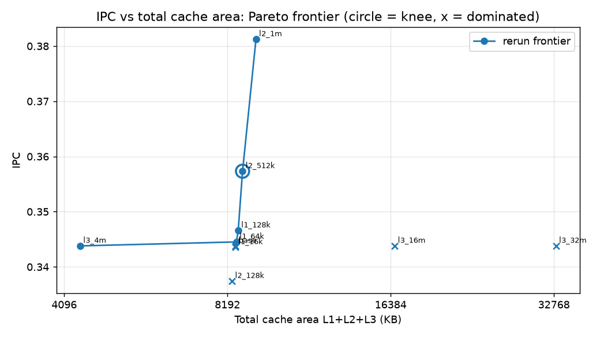
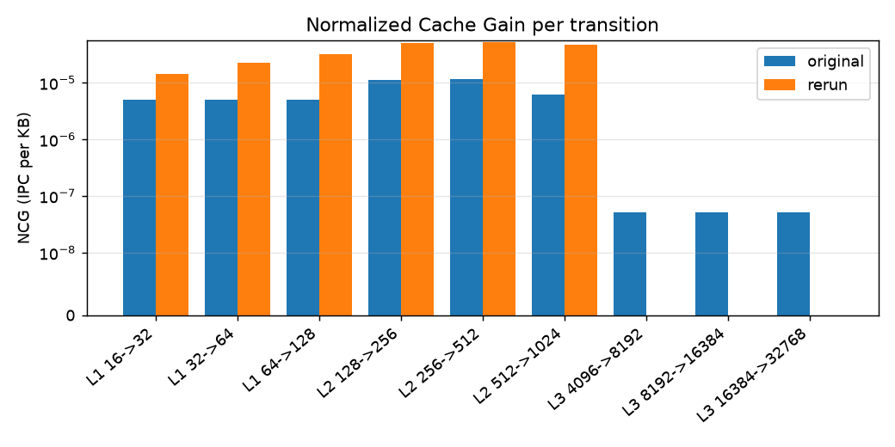
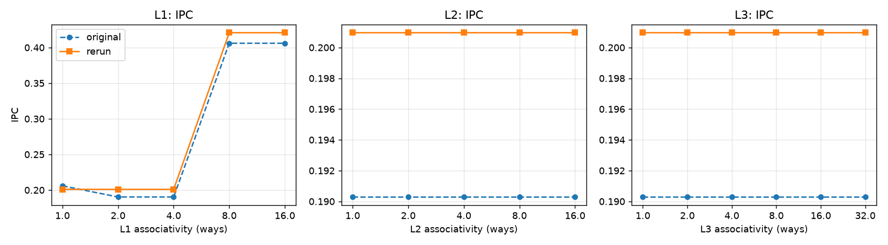

# Cache Hierarchy Performance Analysis: Normalized Cache Gain and Pareto-Optimal Design

**How much performance does each kilobyte of cache buy, and where should you stop adding cache?**
A gem5 study of L1/L2/L3 size and associativity: 24 simulated configurations, a new *Normalized Cache Gain* metric and a Pareto frontier of IPC against cache area.


<p align="center">
  <br>
  <em>IPC against total cache area. The circled knee (L1 32 KB / L2 512 KB / L3 8 MiB) reaches 94 % of peak IPC at 26 % of the largest design's area.</em>
</p>

## Why this project

Bigger caches always help a little, but cache is the most area-hungry part of a chip. A plain IPC-vs-size table doesn't tell you *which* level to grow or when to stop. This project adds two tools to the usual gem5 sweep:

- **Normalized Cache Gain (NCG)** = ΔIPC / ΔCacheSize, in IPC per KB. It measures the performance gained for each kilobyte of cache added at each level.
- **A Pareto frontier** of IPC against total cache area (L1+L2+L3). Its knee is the most cost-efficient design.

## Key findings

| Finding | Result |
|---|---|
| Best place to spend cache area | **L2**: highest NCG of any level, peaking at the 256 → 512 KB step |
| Pareto knee | **L1 32 KB / L2 512 KB / L3 8 MiB**: 94 % of peak IPC at 26 % of the maximum area |
| L1 associativity threshold | Going to **8-way** removes the conflict misses: IPC 0.20 → 0.42, L1 miss rate 99.8 % → 0.02 %, replacements 9.3 M → 1,439 |
| "Miss-latency paradox" | Larger L2 has *lower* miss rate (90.8 % → 4.4 %) but *higher* average miss latency (46 → 96 cycles), because only the hardest misses remain |
| L3 | Negligible NCG for these working sets |

Every finding in the submitted report was reproduced by a fully scripted re-run, except one minor effect. The comparison, and four corrections to the original report (latency units, which gem5 statistic to use, physical indexing in SE mode), are in [`docs/RESULTS.md`](docs/RESULTS.md).

## How it works

```
benchmarks/*.c ──► gem5 (ARM, SE mode) ──► stats.txt ──► parse_ncg.py ──► NCG, Pareto, tables
 size sweep         TimingSimpleCPU 1 GHz     24 runs        IPC, CPI, miss     plot_results.py
 assoc conflict     L1I/L1D, L2, L3, DDR4                    rate, latency      ──► figures
```

| | Baseline system |
|---|---|
| Simulator | gem5 v25.1, ARM ISA, Syscall-Emulation mode |
| CPU | TimingSimpleCPU @ 1 GHz, exactly 50 M instructions per run |
| L1I / L1D | 32 KiB, 2-way, 2 cycles |
| L2 | 256 KiB, 8-way, 10 cycles |
| L3 | 8 MiB, 16-way, 20 cycles |
| Memory | DDR4-2400, 512 MiB |

Two micro-benchmarks isolate the two effects:

- **`cache_size_sweep.c`** streams `sum += arr[i]` over working sets from 4 KiB to 64 MiB. It isolates capacity misses.
- **`assoc_conflict.c`** cycles through 8 lines that map to the same L1 set. It gives a sharp threshold at 8-way.

Each experiment varies one level while the others stay at baseline. Sizes: L1 16–128 KiB, L2 128 KiB–1 MiB, L3 4–32 MiB. Associativity: 1 to 16-way (32-way for L3).

<p align="center">
  
  
</p>

## Repository layout

```
benchmarks/   cache_size_sweep.c, assoc_conflict.c, Makefile (static AArch64)
configs/      three_level.py: the gem5 system (CPU, L1I/L1D, L2, L3, DDR4)
scripts/      experiments.py (the 24 runs), run_sweep.py, parse_ncg.py, plot_results.py, build_gem5_arm.sh
results/      runs/<name>/ raw gem5 output; rerun/, original/, comparison/ tables and figures
original/     the team's original gem5 stats.txt dumps
docs/         RESULTS.md (re-run vs report), HOW_TO_RUN.md
report/       submitted report (PDF)
```

## Running it

Building gem5, running the sweep and regenerating every table and figure: see **[docs/HOW_TO_RUN.md](docs/HOW_TO_RUN.md)**.

## Report

[`report/Cache_Hierarchy_NCG_Pareto_Report.pdf`](report/Cache_Hierarchy_NCG_Pareto_Report.pdf): the submitted report.

## Team

BEVD207L Computer Architecture, VIT Vellore. Supervisor: Vikas Vijayvargiya.

| Name | Reg. No. |
|---|---|
| Arrnav Trisal | 24BVD0064 |
| Gavin Fernandez | 24BVD0083 |
| Ashutosh | 24BVD0065 |
| Varun V Nair | 24BVD0061 |
